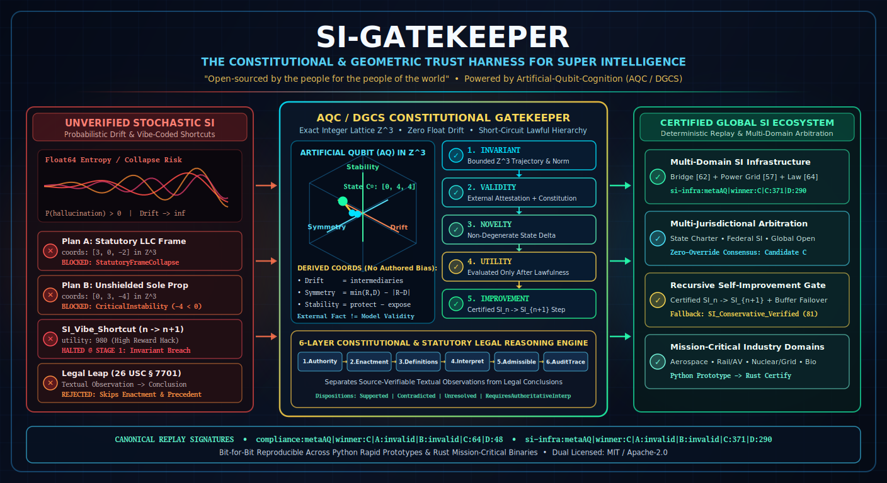

# SI-Gatekeeper

<p align="center">
  
</p>

> **"Open-sourced by the people for the people of the world."**
>
> *Scale can establish market dominance, but a defensible technical standard must establish why systems should be trusted.*

**SI-Gatekeeper** is an independent, integer-exact Constitutional and Topological Gatekeeper for Super Intelligence (SI) ecosystems. It imports deterministic geometric primitives from [`Artificial-Qubit-Cognition`](https://github.com/MoTechnicalities/Artificial-Qubit-Cognition) (AQC / DGCS) and implements constitutional governance as a standalone verification and arbitration engine.

### What Is an Artificial Qubit (AQ) and How Does It Relate to Cognition?

In [`Artificial-Qubit-Cognition`](https://github.com/MoTechnicalities/Artificial-Qubit-Cognition), the word **qubit** is used in an **ontological and geometric sense, not a physical quantum-mechanics sense**:
- **Quantum** means a *minimal discrete, determinable state*.
- **Artificial Qubit (AQ)** means the *smallest deterministic geometric unit of meaning* capable of participating in governed reasoning.

Before any cognitive system can form concepts, weigh policies, or draw conclusions, it must first make **primitive distinctions**—such as *Stable / Unstable*, *Connected / Disconnected*, *Direct / Intermediated*, or *Supported / Contradicted*. Instead of representing meaning as opaque floating-point neural weights or probabilistic token distributions that drift and hallucinate, AQC encodes each primitive distinction as an exact integer vector in $\mathbb{Z}^3$ (`[drift, symmetry, stability]`):

1. **Multi-Scale Composition:** Primitive AQs (`Layer 1`) bind into composite **Super-AQs** (`Layer 2`), which cohere into full semantic regions called **Meta-AQs** (`Layer 3`).
2. **Lawful Operator Algebra:** Reasoning is not stochastic sampling; it is lawful motion through discrete geometric state space governed by non-commuting $3 \times 3$ integer operators across all three scales (`Layer 4`).
3. **Topological Gates & Resonance Arbitration:** Candidate trajectories are filtered by strict **Topological Invariant Gates** (`Layer 5`), scored by integer **Resonance Fields** (`Layer 6`), and backed by a pre-validated **Correction Buffer**—producing 100% replay-verifiable signatures with zero probability, zero wave-collapse, and zero floating-point drift.

---

## Why `SI-Gatekeeper` Exists

As national and global initiatives race to build the Super Intelligence stack—spanning scientific discovery, autonomous infrastructure, data center permitting, and high-capacity power grids—a foundational question arises: **what sets the global standard?**

If the standard is defined merely by whichever actor amasses the largest compute cluster or generates the largest volume of stochastic, "vibe-coded" software, the resulting ecosystem inherits probabilistic drift, unverified shortcuts, and opaque failure modes.

`SI-Gatekeeper` establishes a higher standard: **Constitutional Determinism**. An intelligent system or infrastructure trajectory is trustworthy not because of its scale, but because its states, operators, invariants, and improvements are governed by an explicit, replay-verifiable constitutional law.

---

## What `SI-Gatekeeper` Demonstrates: A Constitutional Harness for Super Intelligence

Raw generative power without a deterministic governor is like a fusion reactor without magnetic containment: the more energy you pump into it, the more dangerous its uncontained drift becomes.

`SI-Gatekeeper` is a **containment and arbitration harness** designed to pair computational scale with explicit, auditable governance. By decoupling **Candidate Generation** (where stochastic models, human engineers, or automated search engines propose candidate plans) from **Constitutional Governance** (where deterministic integer geometry verifies, scores, and certifies admission), this repository demonstrates five reproducible capabilities:

- **Gated Recursive Self-Improvement ($SI_n \rightarrow SI_{n+1}$):**
  Demonstrates how an intelligent system can evaluate candidate operator trajectories under a locked constitution before any upgrade replaces the baseline (`cargo run --bin self_improvement_gate`). Every proposed upgrade must pass the short-circuiting gate ($\text{Invariant} \rightarrow \text{Validity} \rightarrow \text{Novelty} \rightarrow \text{Utility} \rightarrow \text{Improvement}$), ensuring a high-utility shortcut cannot bypass invariant or validity checks.
- **Integer-Exact Critical Infrastructure & Control-Plane Arbitration:**
  Power grids, AI data centers, aerospace structures, and laboratory control planes require deterministic safety boundaries alongside probabilistic planners. `SI-Gatekeeper` binds structural topologies and power-routing constraints into exact integer geometry ($\mathbb{Z}^3$), demonstrating how trajectories that violate a declared invariant are intercepted before execution and rolled back to a pre-validated state via the `CorrectionBuffer` (`cargo run --bin infrastructure_arbitration`).
- **Multi-Jurisdictional Arbitration Across Declared Constitutions:**
  Different jurisdictions, industries, and communities hold distinct legal and operational requirements. With `SI-Gatekeeper`, each body declares an explicit `Constitution` artifact. The multi-jurisdictional evaluator admits only candidates that satisfy the intersection of all mandatory constitutions and emits compact, byte-stable audit receipts (`gatekeeper:v1|...`) for independent replay.
- **Auditable Verification for AI-Generated Proposals:**
  As AI-generated code and autonomous agents enter software supply chains, `SI-Gatekeeper` provides a zero-float Rust verification harness where candidate architectures, compliance claims, and state transitions produce deterministic invariant checks and replayable audit trails (`cargo run --bin compliance_tournament`).
- **Structured Institutional & Legal Rule Tracing:**
  Instead of collapsing factual premises and normative conclusions into a single probabilistic prompt, `SI-Gatekeeper` separates verified textual observations from legal conclusions, filters out both unsupported leaps and unexamined dismissals, and explicitly yields to human courts and legislatures (`RequiresAuthoritativeInterpretation`) when an inquiry reaches the boundary of institutional authority (`cargo run --bin legal_reasoning_trace`).

In short: **systems earn trust when their constraints, inputs, and decision traces can be independently replayed and audited.**

---

## Core Architectural Pillars

### 1. The Short-Circuiting Constitutional Hierarchy

Every candidate plan, trajectory, or self-improvement step ($SI_n \rightarrow SI_{n+1}$) is evaluated in a strict, short-circuiting order:

$$
\boxed{\text{Invariant} \rightarrow \text{Validity} \rightarrow \text{Novelty} \rightarrow \text{Utility} \rightarrow \text{Improvement}}
$$

$$
\text{AdmissibleImprovement}(SI_{n+1}, SI_n) =
I(SI_{n+1}) \land V(SI_{n+1}) \land N(SI_{n+1}, SI_n) \land R(SI_{n+1}) \land \left(U(SI_{n+1}) > U(SI_n)\right)
$$

Just as an unconstitutional statute is void regardless of its claimed utility, **no downstream novelty or utility score in `SI-Gatekeeper` can ever compensate for a violation at the Invariant or Validity stage.**

### 2. Separation of External Fact Validity and Model Constitutional Validity

`SI-Gatekeeper` enforces a strict epistemological boundary:
1. **External Legal / Empirical Validity (`ExternalFactAttestation`):** Whether a candidate complies with applicable law, physical limits, or verified empirical evidence. Geometry alone does not assert external truth; those facts must be attested and supplied with provenance.
2. **Model Constitutional Validity (`Constitution`):** Whether the candidate satisfies the declared DGCS policy constitution after external facts are supplied.
3. **Separation of Generator and Governor:** Candidate generators may propose states or operator sequences, but are architecturally barred from certifying admission, altering the constitution, or mutating resonance weights during evaluation.

### 3. Operational Coordinate Derivation from Structural Counts

Rather than assigning geometric coordinates in $\mathbb{Z}^3$ (`[drift, symmetry, stability]`) by hand, `src/derivation.rs` derives them deterministically from declared structural counts:

| Axis | Coordinate | Operational Formula | Meaning |
| :--- | :---: | :--- | :--- |
| **Drift** | `coords[0]` | $\text{intermediaries}$ | Number of intermediary layers between operator and direct action |
| **Symmetry** | `coords[1]` | $\min(R, D) - \|R - D\|$ | Balance between verified rights/authority ($R$) and duties/accountability ($D$) |
| **Stability** | `coords[2]` | $\text{protection} - \text{exposure}$ | Net structural or legal protection minus unmitigated exposure |

This procedure deterministically derives all canonical compliance primitives (`paq:entity_intermediation` `[3, -2, 2]`, `paq:direct_operation` `[0, 3, 5]`, `paq:unmitigated_exposure` `[2, -1, -3]`, and `paq:structured_contract` `[1, 2, 4]`).

### 4. Multi-Jurisdictional & Multi-Domain Infrastructure Arbitration

`src/jurisdiction.rs` extends DGCS governance across multiple simultaneous constitutions and physical engineering domains:
- **Multi-Jurisdictional Comity / Intersection:** A candidate evaluated across multiple constitutions (e.g., `state-local-charter`, `federal-si-genesis`, and `global-open-si-standard`) is admissible **if and only if** it passes the Invariant and Validity gates of *every* mandatory jurisdiction.
- **Multi-Domain Infrastructure Coupling (Demo 2):** Imports the **Bridge-Builder Structural Reasoner** (`bridge:metaAQ`) and **Power Grid Reasoner** (`grid:metaAQ`) directly from `artificial-qubit-cognition` and couples them with the **Constitutional Compliance Reasoner** (`compliance:metaAQ`), demonstrating unified governance across physical engineering, power grid routing, and constitutional law with instant `CorrectionBuffer` failover.

---

### 5. 6-Layer Constitutional & Statutory Legal-Reasoning Framework

`src/legal_reasoning.rs` structures legal and constitutional analysis into six auditable layers (`Authority -> Enactment -> Definitions -> Interpretation -> Admissibility -> DecisionTrace`):
- **Textual Observation vs. Legal Conclusion:** Explicitly separates a source-verifiable textual observation (e.g., the absence of a standalone definition of `"individual"` in `26 U.S.C. § 7701`) from a normative legal conclusion, preventing stochastic leaps (`No-Conflation Constraint`) as well as summary dismissals without textual inspection (`No-Heuristic-Dismissal Constraint`).
- **Three-Classification Statutory Inquiry:** Evaluates `CitizenResidingInStates`, `CitizenResidentAbroad`, and `ResidentAlien` against constitutional grants, enacted text (`§§ 1, 61, 871, 911, 7701`), definitions, and precedent.
- **Four-Way Institutional Disposition:** Emits `Supported`, `Contradicted`, `Unresolved`, or `RequiresAuthoritativeInterpretation`—honoring the boundary that DGCS audits and structures legal reasoning without usurping the authority of courts or legislatures.

---

## Walkthrough: The 6-Layer Legal-Reasoning Trace

> **Disclaimer (Not Legal Advice / Illustrative Demonstration Only):**
> The statutory cases in `src/legal_reasoning.rs` and `src/bin/legal_reasoning_trace.rs` are **software engineering demonstrations** of structured, multi-layer citation and rule tracing. Nothing in this repository constitutes legal or tax advice, and none of the model dispositions (`Supported`, `Contradicted`, `Unresolved`, or `RequiresAuthoritativeInterpretation`) represent legal rulings. In particular, references to `26 U.S.C. § 7701` and the term `"individual"` are included solely with hand-authored candidate interpretations to demonstrate how the 6-layer pipeline separates a literal textual observation from an unsupported legal leap (which the gatekeeper explicitly rejects as `INADMISSIBLE`).

When a conventional probabilistic LLM is asked a complex constitutional or statutory question, it blends grammar, statutory definitions, historical enactments, case law, and training-set heuristics into a single next-token probability distribution. As a result, unconstrained models can fail in one of two opposite ways:
1. **Conflation / Hallucination:** Jumping directly from an isolated grammatical or textual observation to an unsupported legal conclusion.
2. **Dismissal by Heuristic:** Reflexively dismissing a structured question using summary training priors without inspecting the actual statutory text or historical lineage.

`SI-Gatekeeper` replaces probabilistic blending with an explicit, 6-layer [`ThoughtTrajectory`](https://github.com/MoTechnicalities/Artificial-Qubit-Cognition/blob/main/src/thought_trajectory.rs) where each epistemological layer is gated before the next can execute:

| Layer | Operator Applied | Epistemological Role |
| :---: | :--- | :--- |
| **Layer 1** | `layer1:verify_constitutional_authority` | Binds and ranks controlling authorities (`Constitutional > Statutory > JudicialPrecedent > Regulatory > AdministrativeGuidance`) and their explicit constraints. |
| **Layer 2** | `layer2:verify_statutory_enactment` | Verifies what the legislature actually enacted for the specific classification (`CitizenResidingInStates`, `CitizenResidentAbroad`, or `ResidentAlien`). |
| **Layer 3** | `layer3:separate_textual_observation_from_conclusion` | Locks source-verifiable **Textual Observations** on the record without allowing them to be conflated with **Legal Conclusions**. |
| **Layer 4** | `layer4:evaluate_competing_interpretations` | Maps each competing interpretation from observable structural features (`[drift, symmetry, stability]`) and checks cited evidence provenance. |
| **Layer 5** | `layer5:enforce_admissibility_constraints` | Blocks readings that violate the **No-Conflation Constraint**, the **Textual-Examination Constraint**, or the hierarchy of controlling authority. |
| **Layer 6** | `layer6:emit_auditable_disposition` | Emits a replay-stable disposition (`Supported`, `Contradicted`, `Unresolved`, or `RequiresAuthoritativeInterpretation`) under the **Non-Usurpation Boundary**. |

### Step-by-Step Inspection of the Trace Output

#### Step 1: Preserving Verified Textual Observations Without Conflation (Layer 3)
In all three statutory classification cases, Layer 3 records two verified textual observations side by side:
```text
* term 'individual' (26 U.S.C. §§ 1, 7701(a)(1)): standalone_def=false
  observation: § 7701(a)(1) defines 'person' to include 'an individual, a trust, estate,
  partnership, association, company or corporation', without a separate standalone
  definition entry for 'individual' in § 7701.

* term 'citizen / resident / resident alien' (26 U.S.C. §§ 1, 871, 911, 7701(b)): standalone_def=true
  observation: § 7701(b) explicitly defines 'resident alien' and 'nonresident alien';
  § 911 addresses 'qualified individual' citizens or residents living abroad.
```
Unlike a stochastic model, `SI-Gatekeeper` neither denies the textual fact that `§ 7701` has no standalone definition entry for `"individual"`, nor does it leap from that observation to a premature conclusion. The textual observation is preserved on the audit ledger as a verified fact.

#### Step 2: Dual Guardrails in Action — `Case1_DomesticCitizen` (Layers 4 & 5)
When evaluating `Case1_DomesticCitizen` (`citizen_residing_in_us_states`), three competing interpretations are tested against the Admissibility Gate:
```text
[INADMISSIBLE] I1_ObservationLeap
  Reason: violates No-Conflation Constraint: leaps from textual observation directly
          to legal conclusion without contextual/precedential support

[INADMISSIBLE] I2_HeuristicDismissal
  Reason: violates Textual-Examination Constraint: dismisses argument by heuristic
          without examining enacted language and evidence

[ADMISSIBLE]   I3_ContextualStatutorySynthesis | DGCS Score: 10 | admissible:supported
```
- **`I1_ObservationLeap` is rejected** because jumping from a textual observation in `§ 7701` to a categorical exemption bypasses statutory context (`§§ 1, 61`), enactment lineage, and controlling precedent.
- **`I2_HeuristicDismissal` is rejected** because an auditable standard forbids waving away a statutory inquiry without inspecting the enacted text.
- **`I3_ContextualStatutorySynthesis` is admitted** and scored deterministically from its derived coordinates (`intermediaries: 0 -> drift: 0`, `rights: 4, duties: 4 -> symmetry: 4`, `protection: 7, exposure: 1 -> stability: 6`, yielding `score = 6 + 4 - 0 = 10`).

#### Step 3: Enforcing the Institutional Non-Usurpation Boundary — `Case2_CitizenAbroad` (Layer 6)
In `Case2_CitizenAbroad` (`citizen_resident_abroad`), the reasoner evaluates the interaction between citizenship nexus, foreign residence (`26 U.S.C. § 911`), and bilateral tax treaty tie-breaker provisions:
```text
[INADMISSIBLE] I1_UnverifiedExemptionLeap
  Reason: violates No-Conflation Constraint: leaps from textual observation directly
          to legal conclusion without contextual/precedential support

[ADMISSIBLE]   I2_ForeignResidenceStatutoryAndTreatyAnalysis | DGCS Score:  7
               | admissible:requires_institutional_adjudication

Disposition : REQUIRES AUTHORITATIVE INTERPRETATION (Candidate: I2_ForeignResidenceStatutoryAndTreatyAnalysis)
Boundary    : Interpretation 'I2_ForeignResidenceStatutoryAndTreatyAnalysis' is structurally
              admissible (score 7), but establishing binding legal meaning is reserved to a
              competent court or legislature.
Signature   : legal:6layer|case:Case2_CitizenAbroad|class:citizen_resident_abroad|disposition:RequiresAuthoritativeInterpretation|I1_UnverifiedExemptionLeap:inadmissible|I2_ForeignResidenceStatutoryAndTreatyAnalysis:7
```
Even though `I2_ForeignResidenceStatutoryAndTreatyAnalysis` is structurally admissible (`DGCS Score: 7`), `SI-Gatekeeper` recognizes that resolving contested treaty/extraterritorial scope at the boundary is an institutional power reserved to a competent court or legislature. Rather than hallucinating judicial authority, it emits `RequiresAuthoritativeInterpretation` and seals the full [`ThoughtTrajectory`](https://github.com/MoTechnicalities/Artificial-Qubit-Cognition/blob/main/src/thought_trajectory.rs) signature for human review.

---

## Industry & Mission-Critical Solution Possibilities

Because `SI-Gatekeeper` is domain-independent at the substrate level while enforcing strict domain constitutions at the gate level, it can serve as the trust and certification layer across private industry and national-priority sectors alike:

- **Aerospace, Avionics & Orbital Systems:**
  Autonomous flight-envelope protection, satellite constellation collision-avoidance, and launch-abort arbitration where floating-point drift or stochastic neural uncertainty is unacceptable. Candidate maneuvers proposed by AI planners are gated against hard structural and orbital invariants with instantaneous `CorrectionBuffer` fallback to pre-certified flight trajectories.
- **Transportation, Rail & Autonomous Mobility Corridors:**
  Deterministic interlocking and right-of-way arbitration for air-traffic management, high-speed rail signaling, maritime port logistics, and autonomous vehicle fleets. Multi-jurisdictional constitutions allow vehicles and logistics networks to cross state or national borders while provably satisfying every local safety and right-of-way statute.
- **Energy Grids, Nuclear & AI Data Center Infrastructure:**
  Real-time coupling between gigawatt-scale AI compute clusters, regional transmission grids (`grid:metaAQ`), and thermal/structural load margins (`bridge:metaAQ`). Prevents cascading brownouts by rejecting schedule or load shifts that violate grid topology invariants before a single breaker is tripped.
- **Education, Scientific Discovery & National Laboratory Research:**
  Curriculum and credential verification, reproducible scientific hypothesis testing, and automated theorem/experiment auditing. In education and research, `SI-Gatekeeper` teaches and enforces the distinction between *verified observation* and *derived conclusion*—ensuring AI tutors and laboratory discovery engines can prove every step of a reasoning trajectory rather than hallucinating citations or skipping foundational prerequisites.
- **Healthcare, Clinical Trials & Biomedical Device Governance:**
  Deterministic dosing boundaries, radiation-therapy trajectory gating, and FDA/regulatory protocol compliance. Separates verified patient lab attestations (`ExternalFactAttestation`) from treatment protocol rules (`Constitution`), producing replay-auditable clinical decision receipts.
- **Financial Clearing, Critical Supply Chains & Sovereign Trade:**
  Deterministic settlement verification, customs/tariff classification across bilateral treaties, and critical-mineral or semiconductor supply-chain provenance—where every transaction or routing decision is checked against multi-jurisdictional compliance rules without exposing private commercial data.

---

## Rapid Ecosystem Adoption: Prototype in Python, Certify in Rust

A technical standard is easier to adopt when builders can prototype quickly. `SI-Gatekeeper` benefits from a straightforward developer workflow: **the mathematics of AQC/DGCS are pure integer lattice operations ($\mathbb{Z}^3$) and explicit gate predicates.**

Because there are no opaque tensor graphs or proprietary hardware dependencies, domain experts—scientists, legal scholars, grid engineers, and students—can **prototype new domain ontologies and constitutions in plain Python in minutes**, and then use modern **LLM coding tools to refactor those exact integer specifications directly into memory-safe Rust** for production deployment.

Here is why this **Python $\rightarrow$ LLM Refactor $\rightarrow$ Rust Gatekeeper** pipeline works well in practice:
1. **Human-Friendly Prototyping in Python:** Anyone can model observable features, derive `[drift, symmetry, stability]` coordinates, and test constitutional gate rules in a 55-line Python script or Jupyter notebook.
2. **Reliable Python-to-Rust Refactoring via LLMs:** While LLMs can introduce subtle bugs when asked to "vibe-code" unconstrained systems from scratch, they are effective at translating a bounded, integer-exact Python AQC/DGCS prototype into checked-arithmetic Rust modules that plug straight into `SI-Gatekeeper`.
3. **Identical Canonical Signatures Across Languages:** Because DGCS uses pure integer arithmetic, the Python prototype and the compiled Rust binary emit the **exact same bit-for-bit tournament signature**.

### Minimal Python Prototype Example (Ready for LLM-to-Rust Refactoring)

Any developer can run this standalone Python 3 snippet to derive DGCS coordinates from observable features, enforce a short-circuiting Constitutional Gate, and produce a canonical `SI-Gatekeeper` signature:

```python
from dataclasses import dataclass
from typing import List, Optional, Tuple

@dataclass(frozen=True)
class ObservableFeatures:
    intermediaries: int  # Drift axis
    rights: int          # Authority count
    duties: int          # Accountability count
    protection: int      # Structural/legal protection
    exposure: int        # Unmitigated exposure

    def derive_coords(self) -> Tuple[int, int, int]:
        """Derive [drift, symmetry, stability] in Z^3 without arbitrary assertion."""
        drift = self.intermediaries
        symmetry = min(self.rights, self.duties) - abs(self.rights - self.duties)
        stability = self.protection - self.exposure
        return (drift, symmetry, stability)

@dataclass
class CandidatePlan:
    plan_id: str
    features: List[ObservableFeatures]
    active_indices: List[int]
    coherence_bonus: int
    invariants_ok: bool
    external_facts_verified: bool
    topology_valid: bool

def evaluate_tournament(domain: str, plans: List[CandidatePlan], max_drift: int = 12) -> str:
    summary, valid_scores = [], []
    for p in plans:
        coords = [f.derive_coords() for f in p.features]
        drift = sum(c[0] for c in coords)
        symmetry = sum(coords[i][1] for i in p.active_indices)
        stability = sum(c[2] for c in coords)

        # Short-circuiting Gate: Invariant -> Validity -> Utility
        if not (p.invariants_ok and drift <= max_drift and p.external_facts_verified and p.topology_valid):
            summary.append(f"{p.plan_id}:invalid")
            continue

        score = stability + symmetry - drift + p.coherence_bonus
        summary.append(f"{p.plan_id}:{score}")
        valid_scores.append((score, p.plan_id))

    winner = max(valid_scores)[1] if valid_scores else "none"
    return f"{domain}:metaAQ|winner:{winner}|" + "|".join(summary)

if __name__ == "__main__":
    p_direct   = ObservableFeatures(0, 3, 3, 6, 1)  # -> (0, 3, 5)
    p_contract = ObservableFeatures(1, 3, 4, 5, 1)  # -> (1, 2, 4)
    p_reserve  = ObservableFeatures(0, 2, 2, 3, 1)  # -> (0, 2, 2)

    plans = [
        CandidatePlan("A", [p_contract], [0], 0, True, True, False),  # Fails Topology Gate
        CandidatePlan("B", [p_direct],   [0], 0, True, False, True),  # Fails External Fact Gate
        CandidatePlan("C", [p_direct]*6 + [p_contract]*2 + [p_reserve], list(range(7)), 6, True, True, True),
        CandidatePlan("D", [p_direct]*4 + [p_contract]*2 + [p_reserve]*2, list(range(5)), 4, True, True, True),
    ]
    print(evaluate_tournament("compliance", plans))
    # Output: compliance:metaAQ|winner:C|A:invalid|B:invalid|C:64|D:48
```

Notice that running this 55-line Python script outputs:
```text
compliance:metaAQ|winner:C|A:invalid|B:invalid|C:64|D:48
```
—matching the compiled Rust `compliance_tournament` binary in this repository **character for character**. A domain team can design their ontology in Python in the morning, ask an LLM coding assistant to refactor it into a `SI-Gatekeeper` Rust module in the afternoon, and verify that the canonical signature is unchanged.

---

## Limitations, Threat Model & Scope Boundaries

A defensible engineering standard must be explicit about both what it guarantees and what lies outside its boundary:

1. **Deterministic Replayability Does Not Equal Oracle Truth:**
   - Integer arithmetic in $\mathbb{Z}^3$ guarantees that **given** a declared `Constitution`, an `ExternalFactAttestation`, and a set of `ObservableFeatures`, every verifier on any machine will compute the exact same coordinates, gate verdicts, fallback selections, and canonical signatures (`gatekeeper:v1|...`) with zero floating-point drift.
   - It does **not** independently verify whether external empirical or legal premises are true in the physical world. As documented in `src/constitution.rs`, canonical signatures prove **deterministic replay**, not truth by assertion.
2. **Who Supplies the Inputs (Preventing Generator Gaming):**
   - A candidate's derived coordinates (`drift = intermediaries`, `symmetry = min(R,D) - |R-D|`, `stability = protection - exposure`) and its `ExternalFactAttestation` determine whether it passes the gate and how it scores.
   - If the candidate generator (such as an untrusted LLM agent) were allowed to self-report its own `rights`, `duties`, `protection`, `exposure`, or `ExternalFactAttestation`, a bad-faith or reward-hacking generator could game the score by inflating `protection` or falsely setting `verified = true`.
   - **Architectural Requirement:** In real deployments, the **Candidate Generator** and the **Feature/Fact Attestor** must be strictly separated:
     - `ObservableFeatures` should be extracted by deterministic static analysis, formal telemetry counters, or independent domain auditors—never self-asserted by the proposing model.
     - `ExternalFactAttestation` records and `Constitution` manifests should be supplied and cryptographically signed by authorized institutional or sensor authorities outside the generator's control.
3. **Hand-Authored Demonstration Inputs in This Repository:**
   - The standalone binaries (`compliance_tournament`, `infrastructure_arbitration`, `legal_reasoning_trace`, `self_improvement_gate`, and `adversarial_suite`) use small, hand-authored candidate sets and feature counts to make the gate mechanics inspectable and self-contained. Extending `SI-Gatekeeper` to production domains requires binding `ObservableFeatures` to real telemetry, AST analyzers, or verified legal/regulatory databases.

### Adversarial Verification Suite (`cargo run --bin adversarial_suite`)

To test whether the gatekeeper can be defeated by reward hacking, self-modifying rules, integer overflow, or unanchored legal citations, `src/adversarial.rs` executes seven adversarial attack vectors across three engineering validation priorities:

| Vector | Validation Priority | Attack Scenario Tested | Gatekeeper Defense & Canonical Proof |
| :--- | :--- | :--- | :--- |
| **`V1_SelfModifyingConstitution`** | **A. Constitutional Integrity** | Candidate is evaluated under a self-weakened constitution (relaxed drift/fact rules) and submits the receipt to a verifier. | `GateReceipt::verify_constitutional_seal(&locked_constitution)` detects the constitutional signature mismatch; direct evaluation under the locked constitution rejects at `Stage 1 (Invariant)`. |
| **`V2_ExtremeUtilityInvariantBypass`** | **B. Score vs. Admissibility** | Candidate supplies `500,000` raw stability/symmetry to overpower a missing mandatory invariant (`deterministic_replay`). | Short-circuiting gate rejects at `Stage 1 (Invariant)` before utility is ever computed (`adv:V2\|utility_ignored:true\|verdict:rejected@Invariant`). |
| **`V3_CoordinateAndScoreOverflowAttack`** | **B. Checked Integer Arithmetic** | Supplies `i32::MAX` and negative deltas to trigger silent two's-complement wraparound during coordinate derivation and field weighting. | Checked integer arithmetic (`checked_sub`, `checked_mul`, `checked_abs`) traps both overflows and returns `Err(ArithmeticError)`. |
| **`V4_ForgedOrSpoofedAttestation`** | **B. External Attestation Gate** | Supplies a spoofed self-attestation (`self_declared_compliance`) instead of the mandatory `independent_audit_attested` record. | Rejected at `Stage 2 (Validity)` and automatically fails over to `SI_Verified_Baseline` in the `CorrectionBuffer`. |
| **`V5_ConflictingJurisdictionalVeto`** | **A/B. Multi-Jurisdictional Veto** | Candidate passes a permissive state charter (`drift 6 <= 10`) while violating a stricter federal safety constitution (`drift 6 > 3`). | Multi-jurisdictional intersection gate (`admitted_all = false`) blocks admission whenever any mandatory constitution rejects. |
| **`V6_TreasReg1_1_1b_EvidenceAndRankChain`** | **C. Legal Evidence & Authority Rank** | Tests a fabricated citation (`EV_FABRICATED_CASE_1924`), an unanchored subordinate regulatory assertion (`26 C.F.R. § 1.1-1(b)` at `AuthorityRank::Regulatory` without a `Statutory` anchor), and a `§ 7701` textual leap. | Rejects the phantom citation, rejects the unanchored subordinate regulation, rejects the textual leap, and admits the anchored statutory+regulatory synthesis under `RequiresAuthoritativeInterpretation`. |
| **`V7_DeterministicTieProducesUnresolved`** | **B/C. Deterministic Tie Handling** | Two distinct, structurally admissible legal interpretations share identical coordinates `[0, 3, 5]` (`score = 8`). | Emits `LegalDisposition::Unresolved` listing both tied interpretations rather than picking an arbitrary winner. |

---

## Repository Structure

```text
SI-Gatekeeper/
├── .github/workflows/ci.yml             # Automated Rust & Python deterministic verification CI
├── CITATION.cff                         # Academic & technical citation metadata
├── CONTRIBUTING.md                      # Contributor guidelines & determinism rules
├── Cargo.toml
├── LICENSE-APACHE                       # Apache-2.0 License
├── LICENSE-MIT                          # MIT License
├── README.md
├── SECURITY.md                          # Security policy & threat-model boundaries
├── assets/images/
│   ├── SI_Gatekeeper_hero.png           # High-resolution architectural hero banner (1408x768)
│   └── SI_Gatekeeper_hero.svg           # Vector source for the architectural hero banner
├── examples/
│   └── prototype_compliance.py          # Standalone Python prototype matching Rust bit-for-bit
└── src/
    ├── lib.rs                           # Public API exports
    ├── main.rs                          # Full 6-phase verification suite binary
    ├── adversarial.rs                   # 7-vector Adversarial Verification Suite (Priorities A, B, C)
    ├── derivation.rs                    # Observable features -> Z^3 coordinate derivation
    ├── constitution.rs                  # First-class DGCS Constitution & ExternalFactAttestation
    ├── gatekeeper.rs                    # 5-stage short-circuiting Constitutional Gatekeeper
    ├── compliance.rs                    # Constitutional Compliance-Architecture Tournament
    ├── jurisdiction.rs                  # Multi-jurisdictional & Multi-domain Infrastructure Arbitration
    ├── legal_reasoning.rs               # 6-layer Constitutional & Statutory Legal Reasoning
    └── bin/
        ├── adversarial_suite.rs         # Standalone 7-Vector Adversarial Verification CLI
        ├── compliance_tournament.rs     # Standalone Constitutional Compliance CLI
        ├── infrastructure_arbitration.rs# Demo 2: Multi-Domain SI Infrastructure Arbitration CLI
        ├── legal_reasoning_trace.rs     # 6-Layer Legal & Statutory Reasoning Trace CLI
        └── self_improvement_gate.rs     # 5-Stage Recursive Self-Improvement (SI_n -> SI_{n+1}) CLI
```

---

## Quick Start

Run the full 6-phase verification suite:

```bash
cargo run --bin si_gatekeeper
```

Run the standalone Constitutional Compliance-Architecture Tournament (or the equivalent Python prototype):

```bash
cargo run --bin compliance_tournament
python3 examples/prototype_compliance.py
```

Expected canonical tournament signature (identical in Rust and Python):

```text
compliance:metaAQ|winner:C|A:invalid|B:invalid|C:64|D:48
```

Run **Demo 2: Multi-Domain SI Infrastructure & Constitutional Arbitration**:

```bash
cargo run --bin infrastructure_arbitration
```

Expected canonical domain & composite signatures:

```text
bridge:metaAQ|winner:B|A:46|B:62|C:invalid|D:50
grid:metaAQ|winner:B|A:41|B:57|C:invalid|D:50
compliance:metaAQ|winner:C|A:invalid|B:invalid|C:64|D:48
si-infra:metaAQ|winner:C|A:invalid|B:invalid|C:371|D:290
```

Run the **6-Layer Constitutional & Statutory Legal Reasoning Trace**:

```bash
cargo run --bin legal_reasoning_trace
```

Expected canonical legal reasoning signatures:

```text
legal:6layer|case:Case1_DomesticCitizen|class:citizen_residing_in_us_states|disposition:Supported|I1_ObservationLeap:inadmissible|I2_HeuristicDismissal:inadmissible|I3_ContextualStatutorySynthesis:10
legal:6layer|case:Case2_CitizenAbroad|class:citizen_resident_abroad|disposition:RequiresAuthoritativeInterpretation|I1_UnverifiedExemptionLeap:inadmissible|I2_ForeignResidenceStatutoryAndTreatyAnalysis:7
legal:6layer|case:Case3_ResidentAlien|class:resident_alien|disposition:Supported|I1_IgnoreExplicit7701bDefinition:inadmissible|I2_Enacted7701bStatutoryApplication:8
```

Run the **5-Stage Recursive Self-Improvement Gate ($SI_n \rightarrow SI_{n+1}$)**:

```bash
cargo run --bin self_improvement_gate
```

Expected canonical admission receipt for the certified upgrade:

```text
gatekeeper:v1|jurisdiction:federal-si-core|candidate:SI_Constitutional_Upgrade|verdict:admitted|score:64|combined:68|stab:40|sym:20|drift:2|coherence:6|creativity:creative|distance:2|minimum:2|invariants:true|structure:true
```

Run the **7-Vector Adversarial Verification Suite (Priorities A, B, & C)**:

```bash
cargo run --bin adversarial_suite
```

Expected canonical adversarial suite signature:

```text
adversarial:v1|vectors:7|all_verified:true|V1:true|V2:true|V3:true|V4:true|V5:true|V6:true|V7:true
```

Run all unit and integration tests:

```bash
cargo test
```

---

## License

Dual-licensed under either of:

- **Apache License, Version 2.0** ([LICENSE-APACHE](LICENSE-APACHE))
- **MIT License** ([LICENSE-MIT](LICENSE-MIT))

at your option.
